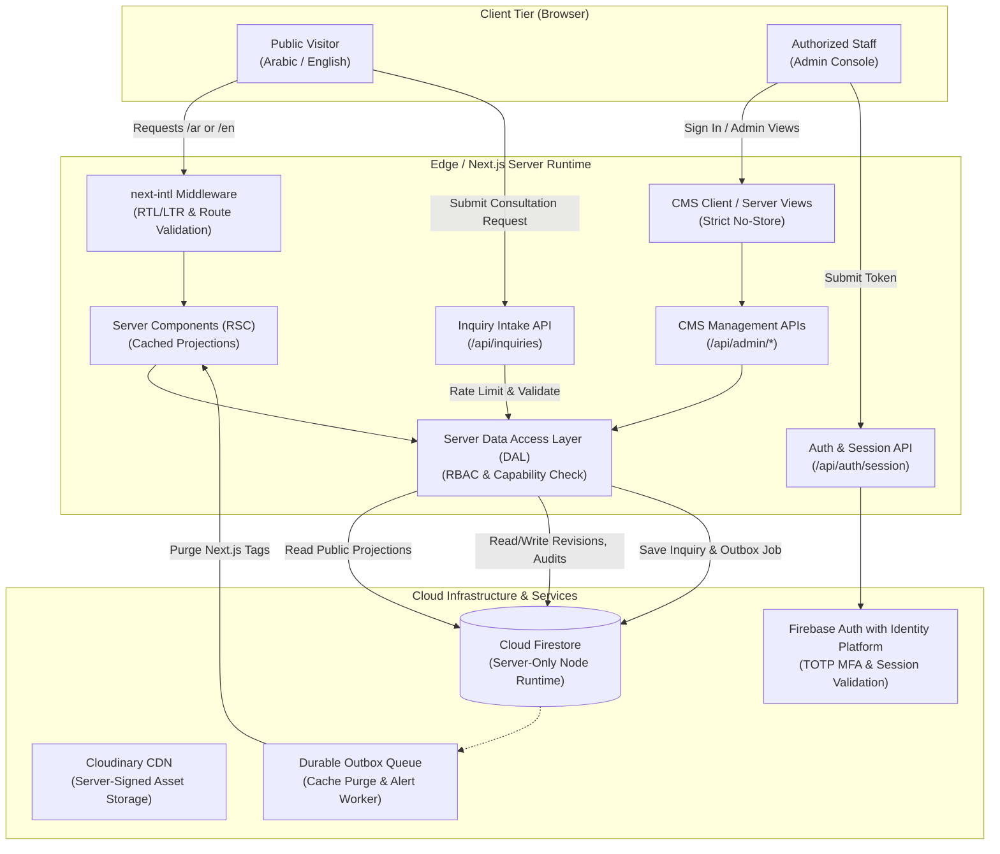
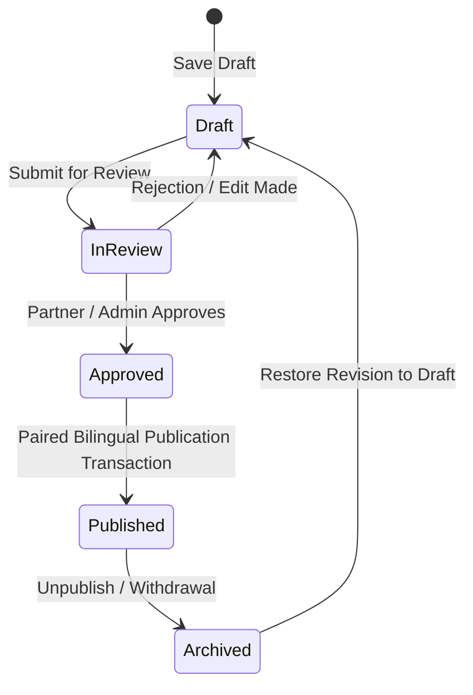

# System Architecture: Riyadh Mohammed Alzahrani Legal Platform

**Version:** 1.0.0  
**Stack:** Next.js 14+ (App Router), TypeScript, Tailwind CSS, Google Cloud Firestore, Firebase Authentication, Cloudinary  

---

## 1. High-Level Architecture Diagram



---

## 2. Boundaries & Rendering Strategy

### Public Front-End
- **React Server Components (RSC):** All standard public routes (`/[locale]`, `/[locale]/about`, `/[locale]/services`, `/[locale]/team`, `/[locale]/insights`, `/[locale]/terms`, `/[locale]/privacy`) render via RSC.
- **Client Components:** Restricted solely to interactive elements: mobile navigation drawer, audience filter pills (`All` / `Individuals` / `Businesses`), interactive contact form, and localized GSAP motion triggers.
- **Data Transfer Objects (DTO):** Public components consume strictly scrubbed DTOs sourced from the `publishedContent` collection. Draft text, internal approval references, audit logs, and reviewer IDs are physically excluded before reaching the renderer.

### Administrative CMS Tier
- **Isolated Protected Boundary (`/admin/*`):** Completely separated from public layouts. Employs `Cache-Control: private, no-store, no-cache, must-revalidate`.
- **RBAC DAL Authorization:** Every Route Handler and Server Action validates the session against the authoritative `adminUsers/{uid}` document in Firestore prior to data retrieval or mutation. UI hiding is purely for ergonomics; security is 100% enforced in server code.

---

## 3. Database Security & Firestore Access Policy

### Zero-Trust Browser Rule
Direct browser client communication with Firestore is categorically rejected. The project includes `firestore.rules`:

```text
rules_version = '2';
service cloud.firestore {
  match /databases/{database}/documents {
    match /{document=**} {
      allow read, write: if false;
    }
  }
}
```

### Server Data Access Layer (DAL)
All database interactions occur via server-side Node modules utilizing the `firebase-admin` SDK or the hardened Development In-Memory Persistence Layer. The DAL handles:
1. **Context Resolution:** Extraction and cryptographically secure verification of the `__Host-session` or `rma_session` cookie.
2. **Authority Lookup:** Retrieval of the user's active status and permission level from `adminUsers/{uid}`.
3. **Audit Trail Generation:** Mandatory creation of an entry in `auditLogs` for any mutating action (save, submit, approve, publish, withdraw, invite, update).

---

## 4. Shared Editorial Content Model & Concurrency

### Dual-State Content Lifecycle
To ensure zero risk of publishing half-finished drafts or breaking active legal claims, each publishable entity (`pages`, `services`, `teamMembers`, `articles`, `siteSettings`) is structured into:
- **Entity Document:** Holds stable non-linguistic metadata (`id`, `audiences`, `relatedIds`, `sortOrder`, `schemaVersion`, `locales.ar`, `locales.en`).
- **Immutable Revision Documents (`revisions/{revisionId}`):** Holds snapshot of content, rich-text blocks, SEO metadata, and creation evidence.
- **Public Projections (`publishedContent/{type}_{id}_{locale}`):** Flat, read-optimized document containing only currently live approved data.



### Optimistic Concurrency Control
All entity updates require supplying `expectedVersion`. If another editor saved a draft revision concurrently, the mutation is rejected with `409 Conflict`, prompting the editor to review the latest revision before proceeding.

---

## 5. Cache & Invalidation Contract

- **Cache Tags:**
  - `content:{entityType}:{id}:{locale}`
  - `listing:{entityType}:{locale}`
  - `navigation:{locale}`
  - `settings:{locale}`
  - `sitemap`
- **Invalidation Target:** On atomic paired publication, the server transaction enqueues an outbox job to execute `revalidateTag()` across all relevant tags. Target latency from publication to public CDN edge propagation is **≤ 60 seconds**.
- **Withdrawal Guarantee:** Unpublishing immediately purges the projection document, marks the route registry as `gone`, and purges CDN cache tags. Stale-while-revalidate is disabled for withdrawn records.
